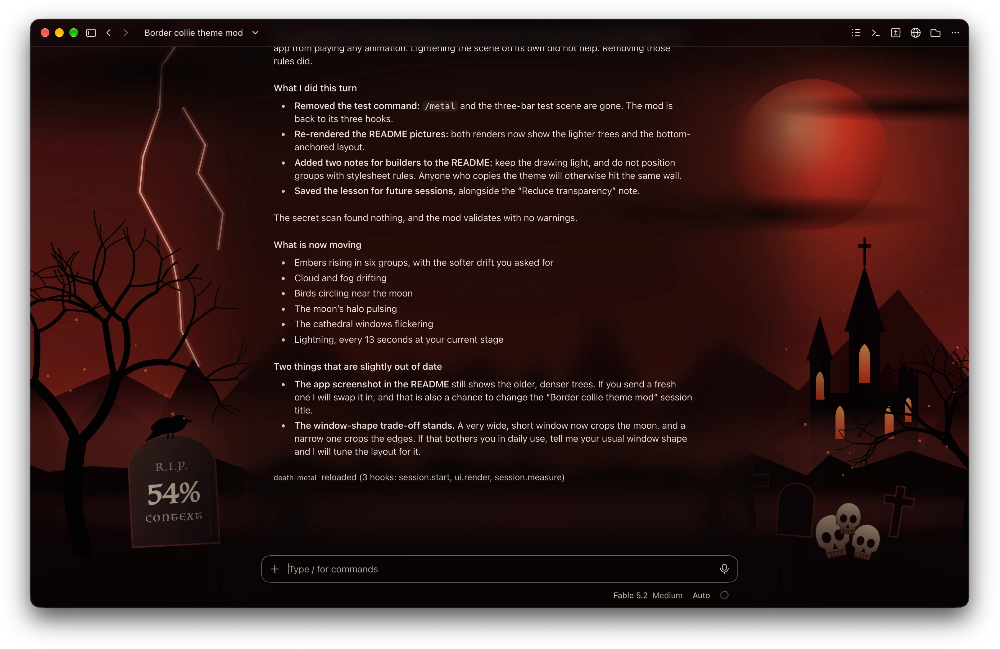
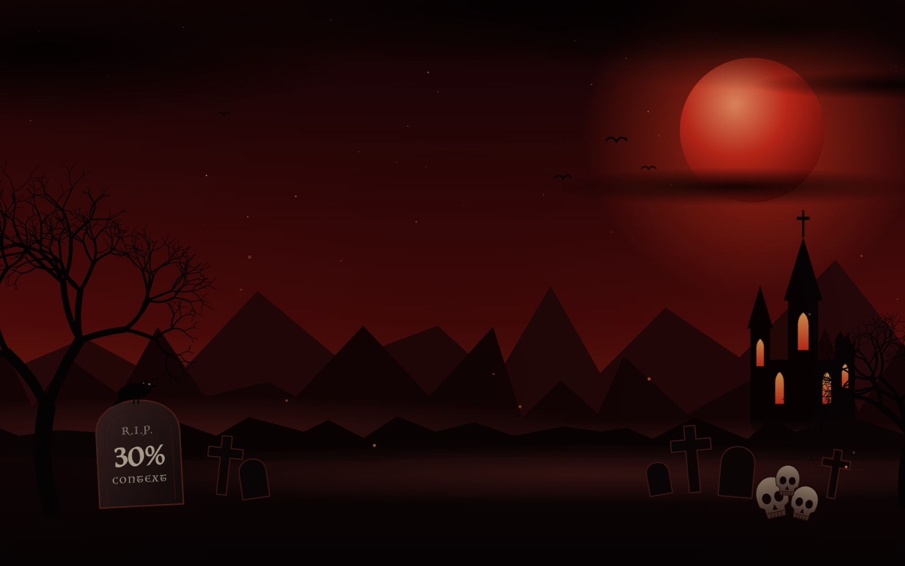
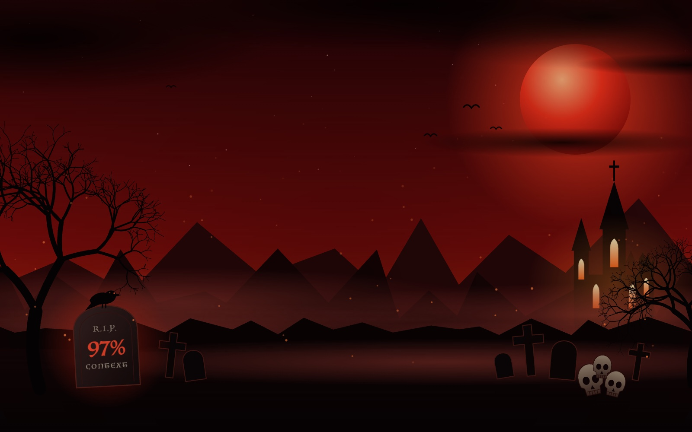

# Death metal theme for Claude

A death metal album cover look for the Claude desktop app: a graveyard under a
blood moon, drawn behind the conversation, with frosted panels over it and
blood-red and bone colors throughout the app.



The theme in the Claude desktop app, at 54% context, caught mid-lightning. The
conversation sits on a frosted panel, and the scene shows around and through it.



The scene alone, at 30% context.

The scene is one SVG (Scalable Vector Graphics) drawing made in code. It uses no
image files and sends nothing anywhere.

## What you get

- **The scene:** a blood moon, jagged mountains, a ruined cathedral with lit
  windows, two dead trees, and a graveyard of crosses, headstones and skulls.
- **Movement:** drifting cloud and fog, rising embers, circling birds and
  lightning.
- **Your context on a headstone:** the large headstone shows how full the
  session's context window is, as a percentage.
- **Colors:** near-black surfaces warmed with red, bone-colored text and a
  blood-red accent. The look is made for dark mode.

## The scene reacts to your context

The scene worsens in four stages as the context window fills. Each stage keeps
what the stage before it added.

| Context      | What changes                                                              |
| ------------ | ------------------------------------------------------------------------- |
| Under 45%    | The calm scene: thin fog, a few embers, lightning every 13 seconds        |
| 45% to 70%   | Thicker fog, more embers, lightning every 7 seconds                       |
| 70% to 90%   | A deeper red sky and moon, and the cathedral windows burn brighter        |
| 90% and over | The figure on the headstone turns red and pulses: it is time to compact   |



The final stage, at 97% context.

The figure updates when a turn ends, because that is when Claude Code measures
the context window.

## Install

At the prompt of a Claude Code terminal session:

```
/plugin install death-metal --marketplace schalkneethling/claude-theme-death-metal
```

Answer `y` to add the marketplace, then choose the user scope so every session
gets the theme.

From a shell:

```bash
claude plugin install death-metal --marketplace schalkneethling/claude-theme-death-metal
```

In the desktop app, where `/plugin` does not run: click + next to the prompt
box, then Plugins, then Add marketplace with
`schalkneethling/claude-theme-death-metal`, then Add plugin.

Then start a new session in the desktop app and send a message.

## What it needs

- **The Claude desktop app.** The terminal and editors draw no backdrop, so the
  theme does nothing there.
- **A recent Claude Code.** The theme was built and tested on Claude Code
  2.1.325.

## If you see the colors but no scene

Check the macOS setting "Reduce transparency", under System Settings,
Accessibility, Display. While it is on, the app draws the frosted panel as a
solid sheet, and that sheet covers the whole scene. Turn the setting off and the
scene appears.

A session holds one theme at a time. If another theme mod is installed, the two
compete for the backdrop, so turn the other one off.

## Motion

All movement stops when your system asks for reduced motion.

## Change it

Everything is in `hooks/register.tsx`:

- `makeColors({ ... })` near the top holds the colors.
- `STAGES` holds the four context stages and the percentage where each starts.
- `buildScene` assembles the drawing from the small `draw...` functions above it.

The plugin icon, `.claude-plugin/icon.png`, is `art/raven-icon.svg` rendered at
1024 by 1024 pixels.

Two things keep the scene moving in the desktop app, both learned the hard way:

- **Keep the drawing light.** The app plays a scene's animations only while the
  drawing stays light, so the trees fork five times, not seven, and the embers
  rise as six groups, not one by one.
- **Do not position groups with stylesheet rules.** An earlier version moved
  parts of the scene with CSS variables and aspect-ratio media queries, and the
  app then played none of the animations. Use `transform` attributes instead.

`hooks/make-colors.js` and `hooks/make-colors.d.ts` are copied unchanged from
Claude Code's plugin-authoring skill, which provides them for mods to copy.

## Remove it

```bash
claude plugin uninstall death-metal
```

## License

The code is MIT licensed, see [LICENSE](LICENSE). The two `make-colors` files
are Anthropic's and are included as the plugin-authoring skill provides them.
